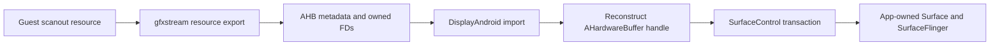

# Android 17 GPU display investigation

2026-10-20. Saved-ROM analysis and public source comparison only. No phone was
connected, no ARM binary was executed or loaded, and no VM/GPU allocation test
was performed. Android 16 remains frozen. Android guest launch and Vulkan remain
disabled in the Android 17 APK. The existing release APK has not been replaced.

## What the ROM establishes

The exact stock crosvm SHA256 remains
`a0cfa5b957d119202b85a069928b3b56bd080329efed42eb83b182c9513885e9`;
its build ID is `7d4a4803787360f36aeeb30eb801f2fb`.
The missing separate `libgfxstream_backend.so` does **not** mean GPU support
was removed. Its MiniDebugInfo identifies nonzero, in-text function bodies:

| Function | Body bytes | Meaning established statically |
| --- | ---: | --- |
| `stream_renderer_init` | 12124 | gfxstream initialization implementation exists |
| `stream_renderer_export_blob` | 156 | renderer resource export implementation exists |
| `create_android_display_context` | 752 | Android display backend exists; calls Binder service lookup |
| `DisplayAndroid::import_resource` | 1196 | Android resource import implementation exists |
| `AndroidSurface::flip_to` | 1008 | imported-resource presentation implementation exists |
| `android_display_flip_to` | 1976 | calls `AHardwareBuffer_createFromHandle` and release |
| `AndroidDisplaySurface::setBufferLocked` | 1128 | AHB acquire/release and display buffer submission body exists |

These are function symbols and original machine-code ranges, not merely debug
messages or source filenames in strings. Definitions, sizes and referenced PLT
symbols are in [the generated analysis](../compatibility/android17-display-analysis.json).
Raw addresses, disassembly, snapshots and the original ELF remain private.

The original ELF has `DF_1_PIE`. Its **dynamic** symbol table exports none of the
`stream_renderer_*`, `gfxstream_backend_*` or `plb_crosvm_*` functions. Therefore
the stock executable does not offer the Bridge's required `dlopen`/`dlsym` API,
even though MiniDebugInfo can name its internal implementation. Do not convert
the host executable into a library by patching its flags, rewrite it, or call
addresses found by this inspector. A separately built app-private runtime is
the appropriate integration point.

## Reference sources and their limits

The public Android 17 release branches were resolved to immutable revisions:

- crosvm: `c7dd8d6950912fa5e6fde7ec2d1616e0ddc090f8`
- Virtualization module: `22f1c9ee92b146e10c8f5e71338618f77ab1631e`
- rutabaga: `1f181b0b3e4b821459f21fd9025cd4c408c4f9ec`

The Android 17 manifest locates rutabaga at `external/rust/rutabaga_gfx`, rather
than inside crosvm. Using crosvm `main` initially found an older display path
without AHB imports; that was not treated as the ROM's implementation. This
matters when rebuilding the renderer: use a coherent release source set.
Source URLs, revisions, sizes and download hashes are [recorded separately](../compatibility/android17-display-sources.json).
These are comparison sources, **not proof of Samsung's exact build inputs**.
The ROM's native Binder symbol names `android::hardware::NativeWindow`, while
source names `android::view::Surface`. The NDK's `android/native_window_aidl.h`
explicitly aliases Surface to NativeWindow; an Android cross-compiler static
assertion confirms their identity. The names are therefore not evidence of an
ABI mismatch. Full vendor-source/build equivalence remains unproved.

The extracted Terminal APK supplies independent confirmation of the Java side:
`DisplayProvider` requests a display Binder, sends separate main/cursor Surfaces,
and removes each when destroyed. Its actual descriptor is
`android.crosvm.ICrosvmAndroidDisplayService`. The observed transaction numbers
are 1 = setSurface, 2 = setCursorStream, 3 = removeSurface. This unstable interface
must not be invoked against an arbitrary Binder based only on a class name.

## GPU-to-display route

The Android 17 source provides this route:



In the [rutabaga export implementation](https://android.googlesource.com/platform/external/rust/rutabaga_gfx/+/1f181b0b3e4b821459f21fd9025cd4c408c4f9ec/src/gfxstream.rs),
platform-AHB resources become metadata plus owned descriptors. The
[scanout implementation](https://android.googlesource.com/platform/external/crosvm/+/c7dd8d6950912fa5e6fde7ec2d1616e0ddc090f8/devices/src/virtio/gpu/virtio_gpu.rs)
tries display import before its transfer/readback fallback. The
[Android display backend](https://android.googlesource.com/platform/packages/modules/Virtualization/+/22f1c9ee92b146e10c8f5e71338618f77ab1631e/libs/android_display_backend/crosvm_android_display_client.cpp)
clones the native handle into an AHB and submits it through SurfaceControl.
Small handle/descriptor copies here are not full-frame pixel readback.

This supplies a plausible path to lower CPU transfer cost and a 60 fps target;
it does not establish working zero-copy across every layer or measured fps.
A failed AHB export/import can select a readback path, so visible output alone
must not be reported as successful GPU buffer sharing.

The reference backend retains the last AHB and reapplies it after Surface
replacement, and drops presentation while the UI has no Surface. That is a
better lifecycle model to investigate than keeping a stale native-window
pointer. Actual ROM reopening/rotation/background behavior remains untested.

## Why the old Surface patch should not be carried over

The frozen Android 16 patch adds a private VMM library entry, passes one owning
process's `ANativeWindow` to `gfxstream_backend_setup_window`, forces a windowed
renderer, and short-circuits the generic resource flush path. The new standard
route instead imports an AHB and presents through its Android display backend.

Porting only the old entry-point names or checksum would miss the new path.
In particular, retaining the old `resource_flush` bypass could skip the AHB
import/flip route that the port needs. The prepared-memory/protection patch
must be reviewed separately; a display change is not a fix for Gunyah ENOMEM,
BAD_PAGE, the earlier Vulkan panic or the reported noisy guest frames.

## Global display-service trap

The reference [backend constructor and destructor](https://android.googlesource.com/platform/packages/modules/Virtualization/+/22f1c9ee92b146e10c8f5e71338618f77ab1631e/libs/android_display_backend/crosvm_android_display_client.cpp)
register/clear a display Binder through the system virtualization service.
The [service implementation](https://android.googlesource.com/platform/packages/modules/Virtualization/+/22f1c9ee92b146e10c8f5e71338618f77ab1631e/android/virtualizationservice/src/aidl.rs)
keeps a single display slot rather than a VM-keyed map, with management/custom-VM
permission checks. Registration can replace the previous slot. The backend's
context constructor ignores the display-name argument; a unique
`--android-display-service` name does not supply isolation in this implementation.
The ROM constructor likewise calls `AServiceManager_waitForService`, and the
Terminal APK waits for the system service's display slot.

Bridge must not use this discovery path, replace/clear the global slot, change
its permissions, or hand an unrelated VM's display to the viewer. Doing so
would conflict with the existing ownership and host-boundary rules.

The preferred private-runtime design is:

1. Build a separate coherent Android 17 VMM/renderer in app-private storage;
   retain original system files and all persistent disks.
2. Retain the stock AHB import/presentation algorithm, but publish the created
   display Binder through an **owned per-session handoff**, with no system
   display registration or global service lookup.
3. Extend the existing root-only Bridge provider/launcher channel with a fresh
   session identity, exact interface/UID validation and Binder death tracking.
   Allow display operations only from the expected Bridge viewer UID; reserve
   setup for the owned root controller.
   No exported general-purpose Binder relay and no raw pointers between processes.
4. Bind main/cursor Surfaces only to that session. Track Surface generations,
   reject stale attach/detach events, remove only owned Surfaces, and preserve
   safe AHB/FD lifetimes until their users finish.
5. Start with GLES and explicit Vulkan disablement. Preserve owner locking,
   memory/protection roles, health/policy/RAM guards and failure-stop behavior.

This is a design, not an implemented Binder handoff or a verified 17 renderer.
The current app's Android guest guard remains false.

## Synchronization and validation still required

The reference Android `flip_to` ignores explicit acquire/release timepoints and
returns a signaled waitable; its C++ transaction uses acquire fence `-1`.
These are not evidence that guest GPU writes, compositor reads or buffer reuse
are synchronized correctly on this device. Trace the resource/virtqueue fence
ordering, validate stride/format/metadata and ownership, and investigate release
completion before removing copies or claiming zero-copy. Never inspect live
protected/donated VMM memory with a debugger or `process_vm_readv`.

Future device tests should separate: no-VM app-owned Surface rendering; owned
Binder reconnect/background/rotation; actual AHB pattern/sequence validation;
and only then a bounded copied-disk GLES VM. Measure CPU/frame age, presented
frames on the owned layer, import/readback choice and fence completion. Timer,
TextureView update or swap-call counts alone are not 60 presented fps. No device
trial, Vulkan re-enable or broader host policy is authorized by this record.

## Reproduce the static analysis

With the saved crosvm whose hash is above and LLVM tools installed:

```sh
python3 tools/inspect_android17_display.py \
  --image artifacts/android17-host/crosvm \
  --output artifacts/android17-host/display-analysis-new \
  --llvm-directory /path/to/llvm/bin
python3 -m unittest discover -s tests -p test_android17_display_inspector.py -v
```

The tool requires a fresh output directory under ignored `artifacts/`, a bounded
regular non-symlink input and the exact file hash. It validates ELF ranges,
bounded MiniDebugInfo decompression, complete function selection, dynamic symbol
visibility and PIE flags before interpreting the result. It disassembles only
saved bytes. It never executes ARM code, patches an ELF, connects to ADB or
allocates a guest. Images and large source checkouts are unnecessary.

## Verification result

The final inspector ran against the exact saved ROM VMM and reproduced the
checked-in analysis JSON, including all seven function ranges, the PIE flag and
an empty dynamic GPU export set. 212 Python/native tests passed, including eight
new inspector tests for undefined/hidden/local symbols, malformed tables,
ambiguous function evidence, symlinks and wrong hashes. The NDK C++ type-alias
check compiled with `-fsyntax-only`; no resulting ARM code was executed.

This update changes research tooling, metadata and documentation. It does not
change `HostContract.ANDROID_GUEST_READY`, remove runtime guards, replace the
published APK, or turn on any GPU/VM experiment.


## Owned connection implementation follow-up

The per-session replacement is now implemented and compiled separately; see
[the implementation and validation limits](android17-owned-display.md). It is
packaged as dormant transport components with the Terminal lifecycle fixes,
without enabling the Android guest gate. The preceding verification result
describes the earlier inspector-only commit, not this later implementation.
