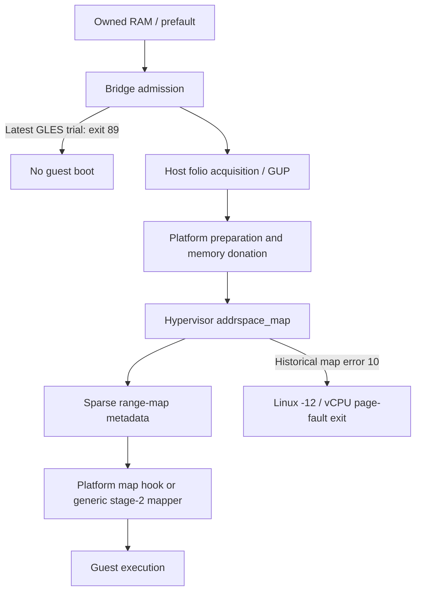

# Gunyah allocation failure: source and retained-log review

Reviewed 2026-10-19, after the one-time GLES trial. **No additional VM, allocation
pressure, policy write, device operation or Android restart was performed.** This
review uses saved logs, the already extracted active-slot kernel image and bounded
public source downloads. The consumed one-trial exception remains consumed.

## Current conclusion

There are two separate blockers:

1. The latest GLES trial stopped inside Bridge's **own prefault-only admission**.
   It obtained the main 1504 MiB mapping, but only 25248/352256 middle pages had
   THP flags. Exit 89 is not a Gunyah error and the Android guest did not boot.
2. Earlier workloads reached Gunyah and failed specifically at **guest-address
   mapping**, after successful host folio acquisition and donation. Hypervisor
   error 10 was then translated into Linux -12. The exact exhausted EL2 resource
   remains unidentified. More free Android RAM does not establish more free
   hypervisor allocator memory.

The complete-middle THP check is a conservative Bridge gate, not a documented
universal Gunyah requirement. Small historical guests worked without full THP
coverage; a historical 3072 MiB trial failed despite full observed small-THP
coverage. Removing the gate would neither diagnose the EL2 allocator nor establish
a safe correction. No guard was relaxed in this review.

## Failure chain and distinct error domains

The related [Linux driver](https://github.com/OnePlusOSS/android_kernel_oneplus_sm8750/blob/8e66bb68fe6735e93ef5dd59c184cf6341b0098d/drivers/virt/gunyah/vm_mgr_mem.c#L109)
obtains a folio, tracks it, performs platform preparation, donates it and finally
maps it. The actual active-slot Galaxy image independently confirms donation
before mapping and the map-failure return branch. Binary images and address-
bearing disassembly remain private. This is an active-slot image observation,
not a claim that every reference source line matches the running kernel.



| Message/context | What it establishes | What it does not establish |
|---|---|---|
| `ANDROID_BACKING_UNSUITABLE` / exit 89 | Bridge refused the observed backing | A failed hypervisor mapping or failed GPU draw |
| Failed **map**, hypervisor 10 | Address-map operation returned NOMEM | Which EL2 allocator, heap or table failed |
| Failed **donate**, hypervisor 111 | Donation returned a different error; retained records subsequently show Linux -22 | Another spelling of map error 10 / Linux -12 |
| `Failed to provide folio ... -12` alone | Outer Linux call failed | An ordinary Linux physical-page allocation was the cause |
| Resource Manager RPC error 7 | An error in a separate RPC domain | The same meaning as hypervisor error 7 or Linux errno 7 |
| Linux OOM text | A Linux kernel reported OOM | Host versus guest scope without identifying the log source |

The [polygraphene guide](https://github.com/polygraphene/gunyah-on-sd-guide#failed-to-initialize-virtual-machine-out-of-memory-os-error-12)
also describes an early DTB-parcel failure caused by locked-memory accounting.
That is a useful separate case, but does not explain our later map-10 record:
the recorded failure occurred after folio acquisition and donation. Raising a
memlock limit indiscriminately is not a demonstrated fix for that later stage.

## What can allocate inside the public hypervisor

Source revision: `quic/gunyah-hypervisor`
`254727746fce809aba0e629a13711a954b246968`. GitHub still returned this revision
as the branch head during this review. It is **not verified Samsung EL2 source**.

### Sparse mapping records

[`hypercall_addrspace_map`](https://github.com/quic/gunyah-hypervisor/blob/254727746fce809aba0e629a13711a954b246968/hyp/mem/addrspace/src/hypercalls.c#L121)
routes a partial mapping to the extent implementation.
[`memextent_map_partial_sparse`](https://github.com/quic/gunyah-hypervisor/blob/254727746fce809aba0e629a13711a954b246968/hyp/mem/memextent_sparse/src/memextent_sparse.c#L1118)
first adds a physical-range-to-guest-address record, before walking the owned
memory and mapping it. Thus NOMEM can occur **before a stage-2 table allocation**.

[`allocate_level`](https://github.com/quic/gunyah-hypervisor/blob/254727746fce809aba0e629a13711a954b246968/hyp/misc/range_map_gpt/src/gpt.c#L486)
allocates a range-tree level from the extent's owning partition. The records
contain both physical ranges and their guest-address relationship. Fragmented
physical backing and mapping compatibility can affect tree shape; configured
guest capacity alone does not determine it.

The fixed `MEMEXTENT_MAX_MAPS` array is also not a proven page-count limit. The
implementation first reuses a matching address-space entry. Exhausting its
mapping slots returns `ERROR_MEMEXTENT_MAPPINGS_FULL`, a distinct named error.
No such error was identified in our map-10 evidence.

The range-map write implementation has explicit rollback and stack cleanup on a
failed write. Therefore it is incorrect to infer an unconditional tree leak
merely because an allocation can fail.

### Generic stage-2 allocation and its fallback

If the generic mapper is used,
[`alloc_level_table`](https://github.com/quic/gunyah-hypervisor/blob/254727746fce809aba0e629a13711a954b246968/hyp/mem/pgtable/armv8/src/pgtable.c#L1490)
requests `ALLOCATOR_MEMTYPE_VM_PAGE_TABLE` through `partition_alloc_ext` on the
address-space object's owning partition.

The reviewed
[`allocator_allocate_object`](https://github.com/quic/gunyah-hypervisor/blob/254727746fce809aba0e629a13711a954b246968/hyp/mem/allocator_list/src/freelist.c#L558)
can try a dedicated S2PT heap when compiled with `PLATFORM_ALLOCATOR_S2PT_HEAP`,
then fall back to the normal hypervisor heap for a non-strict request. The
page-table path creates a default, non-strict hint. The ordinary freelist can
return NOMEM when empty or when no free block satisfies the size/alignment.
Linux `MemAvailable` is not a measurement of either partition heap.

This refines the earlier hypothesis: **a single fixed, isolated page-table pool
is not established even by the generic public source**, much less on Samsung.
We have not obtained the installed EL2 heap totals, largest-free-block statistics
or the actual failing allocation instruction.

### A platform mapper can bypass that generic path

[`addrspace_map_locked`](https://github.com/quic/gunyah-hypervisor/blob/254727746fce809aba0e629a13711a954b246968/hyp/mem/addrspace/src/addrspace.c#L678)
calls a platform map event first. Its result is used directly unless it reports
UNIMPLEMENTED and the page table is not platform-managed. A vendor implementation
can therefore return the observed outer error without reaching the generic
freelist/page-table path above. No evidence here identifies Samsung's selected
platform handler. Increasing a guessed public heap constant would not be an
evidence-based app-side repair, and changing EL2 is prohibited in this project.

## Why smaller folios help without proving a page-table quota

The Linux driver uses a folio's actual size for donation/mapping, even though it
initially pins one userspace page. Larger folios can reduce those operations and
software range metadata. This is why real folio observations matter.

For an **illustrative 4 KiB stage-2 granule**, dense 1 GiB guest RAM needs 512
leaf-table pages when mapped at page granularity: 2 MiB of leaf tables, excluding
upper tables and all other metadata. A 16/32/64 KiB host folio still falls below a
2 MiB block and does not by itself eliminate those leaf tables. A fully aligned
2 MiB physical block may permit a block entry instead. This is geometry, **not a
measurement of Samsung's stage-2 granule, allocator budget or mapping code**.

Accordingly, improvements from small THP do not uniquely identify hardware
page-table exhaustion. Sparse-range bookkeeping, ownership/mapping work, the
platform mapper and its allocator remain candidates. The historical forward
3072 MiB trial had full observed small-THP coverage but still hit map-10 after
1792 MiB write progress. That is also not a complete 1792 MiB readback pass.

## Teardown, external reports and evidence limits

[Gunyah issue #44](https://github.com/quic/gunyah-hypervisor/issues/44) reports
similar map-10 failures on another SM8850 device despite substantial available
host RAM, plus EBUSY during a separate balloon experiment. It remains open with
zero comments at this review; there is no upstream root-cause confirmation or
published fix in that discussion. It is supporting case evidence, not proof of
an identical Samsung defect. Bridge uses `--no-balloon` in these probes.

The public sparse protected-map path does not use the ordinary unprotected
partial-map rollback on every map failure. However, the Galaxy active-slot
driver image **does attempt donation-back after a failed address map**, and
its normal folio reclaim path calls unmap, donation-back, platform reclaim and
only then tree removal/unpin. The driver also has a VM-lifetime cleanup path.
The source and binary observations do not justify saying that it never tries
to release failed mappings.

The reference driver intentionally retains resources when certain reclaim
operations fail rather than reusing memory whose ownership is uncertain. That
makes teardown failure worth investigating, but it is not proof of a leak here.
The bounded retained-log audit found no matching donation-reclaim, unmap,
platform-reclaim, VM-reset or VMID-deallocation failure strings. Missing messages
can reflect rate limiting, overwritten buffers or unexposed EL2 state; the audit
cannot certify successful teardown.

## Correction: the host page-cache warning started earlier

The previous follow-up emphasized the reverse 3072/2048 MiB trial's **242**
messages. Re-reading all retained approved-small-shmem kernel captures found
two earlier bursts, in the same unchanged host boot:

| Captured trial, UTC on 2026-10-19 | Retained distinct `Bad page cache` records |
|---|---:|
| 04:17 forward, 4096/3072 MiB, refault + collapse | 237 |
| 04:22 forward, 4096/3072 MiB, refault + collapse | 231 |
| 08:57 reverse-middle, 3072/2048 MiB | 242 |
| Total across these three captures | **710** |

All three show the mapped-shmem deletion path and subsequent donation error 111
with outer Linux -22. The first two also included collapse; the traces do not
establish which individual combination of advice, prior faulting, splitting and
hole punching exposes the vendor defect. These are **three bursts, not 710 VM
launches**. The earliest retained warning is not proof of the first warning ever;
earlier trials lacked a clean taint baseline.

The previous wording must not be read as "reverse order caused the first warning"
or "all earlier trials ran on a clean host". This earlier evidence was missed in
the prior review. The historical Linux 1536 MiB readback pass at 04:06 preceded
these retained bursts; later Android boot/display successes occurred in the
already affected boot and remain bounded historical results. Initial map-10
failures also predated these warning captures, so the later page-cache anomaly
does not alone explain every original Gunyah failure.

Mapped hole punching remains retired. Neither the warning history nor a usable
Android UI authorizes resetting the consumed exception or another load trial.

## Preallocating or freeing Android memory first

**Subsequent static binary result:** the installed VMM's MiniDebugInfo allowed
inspection of its actual constructor. File-backed mappings take the dedicated
CMA ioctl, and the active-slot kernel verifies dedicated CMA file operations.
Ordinary memfd adoption needs a different ingress in the normal shared-RAM
constructor. [Pinned binary evidence and proposed boundary](preallocated-ram-handoff.md).

Releasing an application's own pages can help its available-memory admission;
it cannot force unrelated live/pinned pages to move or increase an EL2 heap.
The earlier 6112 MiB ordinary allocation/release preparation did not eliminate
the later map-10 failure. The post-GLES buddy snapshot also had no immediately
free blocks at order 4 or above despite available ordinary memory. Those are
different budgets and observations, not a proof of one universal cause.

If useful contiguous backing can be obtained, retaining it and passing **the
same backing object** to the VMM avoids deliberately returning it to the general
allocator and racing to obtain it again. It does not create the initial folios.
Ordinary `mlock` is not a proof of permanent physical contiguity or compatibility
with long-term GUP and protected donation.

The installed VMM's already saved help lists `--file-backed-mapping` and its `ram`
option. But that only establishes option availability. The reviewed
[DroidVM Gunyah backend](https://github.com/Droid-VM/crosvm/blob/849e05f12d5c8d4c36af8e15763986d242cd43b5/hypervisor/src/gunyah/mod.rs#L474)
routes file-backed regions through `GH_VM_ANDROID_MAP_CMA_MEM`; a normal memfd is
not automatically a valid dedicated-CMA descriptor. Another pinned upstream
revision, `6aed5cc351af1aad6b5ec9a0045ffc73b630e56b`, has a different backend
without that file-backed special case. Neither is proved identical to the
installed binary. A normal backing FD, dedicated CMA FD and physical address
must not be substituted for each other on the strength of an option name.

The existing
[shared-memory finalizer](https://github.com/Droid-VM/crosvm/blob/849e05f12d5c8d4c36af8e15763986d242cd43b5/vm_memory/src/guest_memory/sys/linux.rs#L28)
also requires seals. Our earlier detached-tmpfs comparison could not satisfy
that constructor contract. A future original-memfd handoff must preserve exact
size, FD/offset identity, seals, private/shared-region roles and owner lifetime;
no extra live producer mapping may violate the lending assumptions. It must
verify actual folios again after any long-term-pin migration and provide cleanup
without mapped hole punching. **No such handoff is implemented or VM-validated
by this review**, and it would not resolve an exhausted EL2 heap by itself.

## Reproducible next measurements

The new offline tool reads **one saved log from one host boot** and emits only
fixed failure categories, numeric error counts and kernel-uptime warning bursts:

```sh
python3 tools/audit_gunyah_logs.py /private/path/to/saved-kernel.log
```

It deduplicates repeated timestamped records within that log, keeps untimed
records separate, never combines error-number domains, refuses oversized/non-
regular inputs and does not emit raw PFNs, addresses or paths. It neither starts
ADB nor changes a device. Seven new fixture tests cover those distinctions;
the full Python/native suite now has 150 passing tests.

Further discriminators, when a separately permitted healthy test opportunity
exists, are actual folio sizes **at donation**, first-failure stage/size, supported
EL2 allocator totals and largest-free blocks, the selected platform mapper, and
resource accounting before/after a single VM teardown. Kernel flags or a plain
zero VMM exit cannot substitute for them. No new host hook, unknown hypercall,
heap donation, module, global compaction or VM trial is authorized by this list.

[Sanitized audit](data/gunyah-root-cause-review-2026-10-19.json) ·
[Latest GLES trial](android-gpu1536-research.md) ·
[Host boundary](host-boundary.md)
